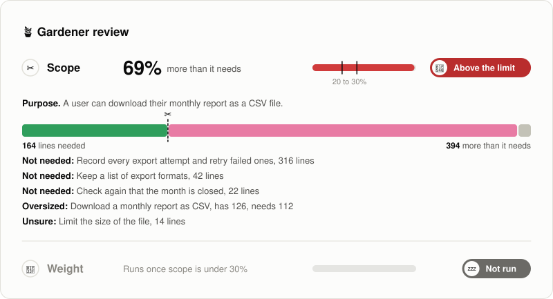
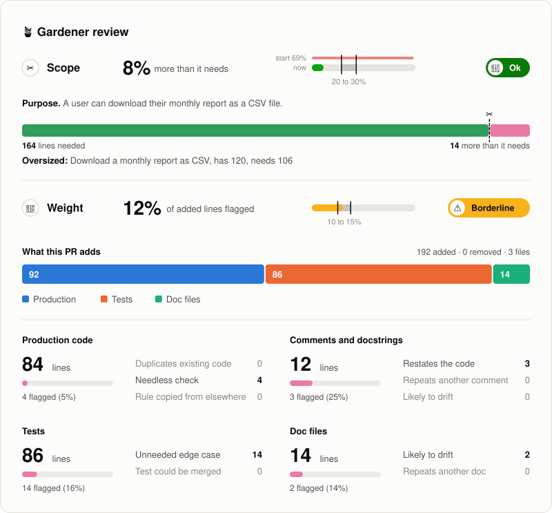

<div align="center">

# 🪴 Gardener

### Oh no!! Bloat on your PR? Call the gardener ✂️

<br>

<picture>
  <source media="(prefers-color-scheme: dark)" srcset="examples/first-push-dark.svg">
  
</picture>

<sub>(A made-up PR, but you've met it: 572 lines written, 164 needed)</sub>

</div>

<br>

## Wait, what is this

You know the PR. Somebody had to add one endpoint and one column, and somehow it came out at a thousand lines. Bro. A thousand lines to save one thing in the database??

The annoying part is that you can't even complain properly, because every line is fine! It has tests! It "handles failures"! So you approve it, and now your repo owns a retry system for something that costs the user one extra click, plus a history table that nobody is ever going to read.

Gardener is a GitHub Action that reads the PR, figures out what it's actually for, and counts how many of those lines the job needed. Then it posts a chart on the PR with the crap coloured pink. Everybody gets the same treatment, including you (sorry).

## Two levels 🎮

**Level 1 is Scope ✂️** It chops the PR into pieces (a function, a table, a background job, plus whatever tests only exist for that piece) and asks about each one: does the thing this PR is for need it? And if it does, how much code would it take if you did it the way the repo already does this kind of stuff? Your score is how much of the PR goes beyond that.

**Level 2 is Weight 🌿** This one goes line by line, looking for the small stuff: code the repo already has somewhere else, checks that can never fire, a test that checks the same thing as the test right above it, comments like `// increment the counter` (thanks). Your score is how many of your added lines got flagged.

| | 🌱 Ok | ⚠️ Borderline | 🥀 Above the limit |
|---|---|---|---|
| ✂️ Scope: lines beyond what it needs | under 20% | 20 to 30% | over 30% |
| 🌿 Weight: added lines flagged | under 10% | 10 to 15% | over 15% |

<div align="center">
<picture>
  <source media="(prefers-color-scheme: dark)" srcset="examples/after-the-cut-dark.svg">
  
</picture>

<sub>Same PR, one haircut later. The chart updates in place and Level 2 is unlocked!</sub>
</div>

## What shows up on the PR

One review, written for someone who has never seen the code. Under the chart you get a table of where the extra lines are. This is the one for the chart at the top:

| Piece | Finding (has → needs) | Why |
|---|---|---|
| **Record every export attempt and retry failed ones** | Not needed<br>316 → 0 | This is what "guaranteed delivery" in the title asks for. One failed download costs the user one more click, the export is free, and no other download here retries. |
| **Keep a list of export formats** | Not needed<br>42 → 0 | The list has one entry, CSV. Nothing adds a second format, here or in the services that call this one. |
| **Check again that the month is closed** | Not needed<br>22 → 0 | The reports service already refuses an open month on the same request, and its own test shows it. |
| **Download a monthly report as CSV** | Oversized<br>126 → 112 | About a quarter of its code is its own CSV writer. The repo already has one, and the invoice download uses it. |
| **Limit the size of the file** | Unsure<br>14 → ? | No limit is written down anywhere. The size of the largest real report would settle it. |

Under the table there's a short list of questions for whoever owns the code ("is a second export format actually planned?"), because some of these calls aren't Gardener's to make. The Level 2 findings go as comments directly on the lines they're about.

## Ok I want it

The reviewer inside the action is a coding agent, and you pick which one: the [Codex CLI](https://github.com/openai/codex) (the default) or [Claude Code](https://github.com/anthropics/claude-code). Either way it has to sign in somehow.

**1.** Add one secret to the repo you want reviewed:

- for Codex, `CODEX_ACCESS_TOKEN`: a Codex access token from a ChatGPT Business or Enterprise workspace, which runs on the workspace's plan
- for Claude, `CLAUDE_CODE_OAUTH_TOKEN`: what `claude setup-token` prints, which runs on your Claude plan (then also set `agent: claude`)

(API keys work too, if you enjoy paying per token: `openai-api-key` or `anthropic-api-key`.)

**2.** Copy [`examples/workflow.yml`](examples/workflow.yml) to `.github/workflows/gardener.yml`:

```yaml
name: Gardener
on:
  pull_request:
    types: [opened, synchronize, reopened, ready_for_review]

concurrency:
  group: gardener-${{ github.event.pull_request.number }}
  cancel-in-progress: true

permissions:
  contents: write        # the chart images live on a branch of their own
  pull-requests: write   # to post the review

jobs:
  review:
    if: ${{ !github.event.pull_request.draft }}
    runs-on: ubuntu-latest
    timeout-minutes: 90
    steps:
      - uses: actions/checkout@v4
        with:
          fetch-depth: 0
          persist-credentials: false
      - uses: Ax6/gardener@main
        with:
          codex-access-token: ${{ secrets.CODEX_ACCESS_TOKEN }}
```

**3.** Open a PR and go make a coffee ☕ Small PRs get their review in a few minutes. The thousand-line ones can take half an hour or more, since the reviewer really does go and read the code around every piece.

<details>
<summary>All the knobs</summary>

<br>

| Input | Default | What it does |
|---|---|---|
| `agent` | `codex` | Which coding agent reviews: `codex` or `claude`. |
| `mode` | `report` | `report` posts the review and passes. `enforce` also fails the job when a level is above its limit. |
| `read-token` | | A read-only token for your organisation's repos (contents and pull requests). With it the reviewer goes and looks things up by itself: who calls this route, does the other service already check this, is the other half of the change sitting in an open PR. |
| `others` | | Repositories this code talks to, one per line: `OWNER/NAME@REF=a few words on what it is`. The reviewer reads them to see what the other side already does. |
| `others-token` | | A token that can read the repositories in `others`. |
| `model` | the reviewer's default | Model for the reviewer. |
| `effort` | `high` | Reasoning effort for the reviewer. |
| `scope-limits` | `20,30` | The two Scope marks, in percent. |
| `weight-limits` | `10,15` | The two Weight marks, in percent. |
| `min-lines` | `30` | Smaller pull requests are skipped. |
| `skip-paths` | | Paths that aren't part of the running application, one per line: `lab/`, `notebooks/`, `*.ipynb`. They're left out of both scores, and the review says how many lines that was. |
| `only-paths` | | The other way round: when set, only these paths are counted. `skip-paths` still wins. |
| `reviewer-command` | `codex exec …` | Use another agent. It gets the task as its last argument and must write the file the task names. |

The action sets three outputs: `scope`, `weight` and `above-the-limit`.

</details>

## Can it block merges?

Yep. With `mode: enforce` the job fails when a level is above its limit. But please run it on `report` for a couple of weeks first and look at what it says about your own PRs before you let it stop anybody else's.

One more thing if you do enforce. A workflow file that lives in the reviewed repo can be edited by the very PR it's judging, which is a pretty funny loophole. An organisation ruleset that requires a workflow from a central repo closes it.

## How the counting works

Models are great at judging code and terrible at adding numbers up, so the model never gets to add anything up. A script sorts every added line first (production, tests, docs, generated, config). The reviewer answers with line ranges and reasons, and it is never asked for a total. Then a script counts what's inside those ranges and draws the chart.

```
scope  = (lines it has − lines it needs) ÷ lines it has        production and test lines
weight = lines flagged ÷ lines added                           code, comments, tests and doc prose
```

<details>
<summary>The fine print</summary>

<br>

- Generated files, config and blank lines are never counted.
- Experiments are yours to keep messy. Put the folders in `skip-paths` and they're left out. The test for what belongs there: if you deleted the folder tomorrow, would anything that runs break?
- Tests count with the piece they belong to: cut the piece and its tests go too, keep it and they all stay. Whether a piece you keep has too many tests is Level 2's call.
- Doc files are left out of Scope. Weight looks at them.
- A piece the reviewer couldn't settle counts as needed and shows up as a question.
- When a Scope score lands within five points of a mark, the review runs two more times and the middle score counts.

</details>

## Rules the reviewer has to follow

The prompts are in [`prompts/`](prompts) and they're pretty much the whole product, so go read them. These do most of the work:

- It has no idea what its score decides. Nobody tells it the limits, or that anything can fail. A judge who knows the pass mark starts aiming for it.
- "Durable", "guaranteed", "hardened" and friends never count as what the PR is for. Those words are how a title asks for extra machinery, and the machinery has to earn its place: what does one failure cost, compared to the lines it adds?
- Some stuff is never bloat: the thing the PR is for and the test that shows it, the only check on input from outside, the only check on who can see or change data, error handling that stops stored data getting lost, and changes the PR forces in other places.
- It has to go and look before it rules. It can't call a line a duplicate until it has found the code being duplicated, and it writes down what it searched for.
- An open PR counts as existing. Half of a change often lives in another repo's PR that isn't merged yet, so with a `read-token` the reviewer checks open PRs before it says "nobody uses this". And when a field in a response has no reader anywhere, that's a question for you ("who is going to read this?") and not a cut.
- Simple words only.

## Run it on your laptop

It's plain Python with nothing to install. With the Codex CLI signed in (or Claude Code, with `--agent claude`):

```bash
git clone https://github.com/Ax6/gardener && cd gardener

python3 -m gardener run \
  --repo ~/code/shop --base origin/main --head my-branch \
  --title "Export monthly reports" --description @description.md
```

If you leave out `--pr` it posts nothing and just leaves the charts and all of the reviewer's notes in `.gardener/`.

```bash
python3 -m unittest discover tests   # the tests
python3 examples/demo.py             # redraw the example charts
```

## Where it's still dumb

- Scores wobble. Run the same review twice and the score can move by a few points, and on one big PR we saw 14. That's why Borderline exists, and why Scope runs two more times when a score lands close to a mark.
- Different models are differently strict. Same PR, same prompt: one model called about 50% of it extra, another about 85%. Both said "way over", but the marks only mean something for the model you set them with, so pick one reviewer and stick to it.
- The Weight marks are a first guess. The Scope marks were picked after looking at where real PRs landed, and Weight hasn't had that yet.
- It's slow. Reading the code around every piece takes minutes.
- It trusts your team. The reviewer reads whatever the PR author wrote, and it runs signed in to the model on your runner. It never gets a token that can write, and the only one it can see at all is the `read-token`, if you set one (so keep that one read-only). Still, use it on PRs from your own people. Fork PRs get no secrets from GitHub, so they don't get reviewed.
- The GitHub Action wrapper is the newest part and the least tried. The review itself has run on plenty of real PRs from the command line.

## Licence

[MIT](LICENSE)
